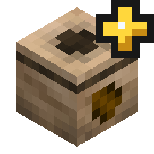
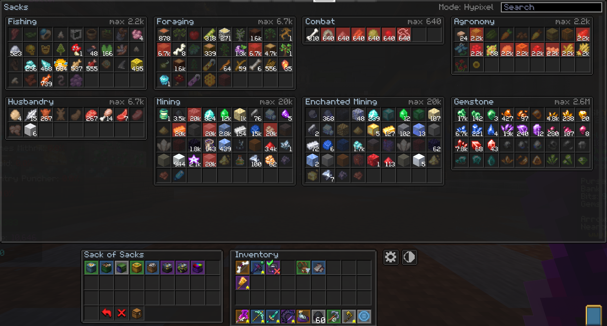

<p align="center"></p>

# Sack Overlay

A client-side Fabric mod for Hypixel SkyBlock (Minecraft 26.2) that replaces the Sack of Sacks menu with a clean overview of all your sacks.



## Features
- One page per sack, with your inventory in its usual place
- Click an item to withdraw it with `/gfs`
- Search, page reordering, light / dark / transparent themes
- Works alongside other SkyBlock mods

## Data
- Sack amounts come from [SkyblockAPI](https://github.com/SkyblockAPI/SkyblockAPI), which reads the `[Sacks]` chat messages and the sack menus.
- The list of items in each sack comes from [meowdding-repo](https://github.com/meowdding/meowdding-repo) (MIT).
- Sack of Sacks slots and capacities are read from the menus you open.
- No extra network requests. The only command the mod sends is `/gfs`, when you click an item.

## Commands
- `/sackoverlay`: open the overview outside the menu
- `/sackoverlay search <text>`: open `/sacks` with a search already typed
- `/sackoverlay config`: open the settings (also available through Mod Menu or the gear button)

Keybinds for opening your sacks and searching the hovered item can be set in Controls.

## Requirements
- Fabric API
- Fabric Language Kotlin
- YetAnotherConfigLib
- Mod Menu (optional)

## Building
```
./gradlew build
```

## Credits
- The look of this screen is inspired by [Skyblock Enhanced Storage](https://modrinth.com/mod/skyblock-enhanced-storage) by Kd_Gaming1. Thanks for such a great storage overlay.
- Thanks to the [SkyOcean](https://modrinth.com/mod/skyocean) team for [SkyblockAPI](https://github.com/SkyblockAPI/SkyblockAPI) and [meowdding-repo](https://github.com/meowdding/meowdding-repo).

## License
MIT
